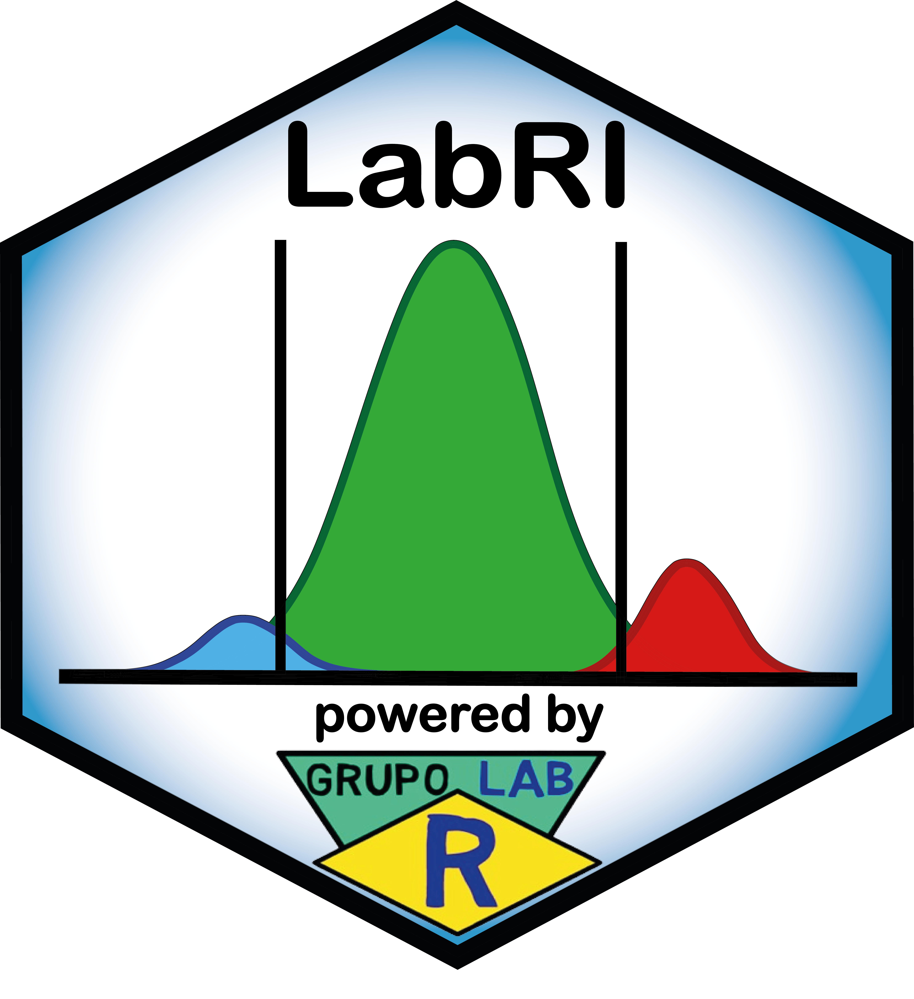
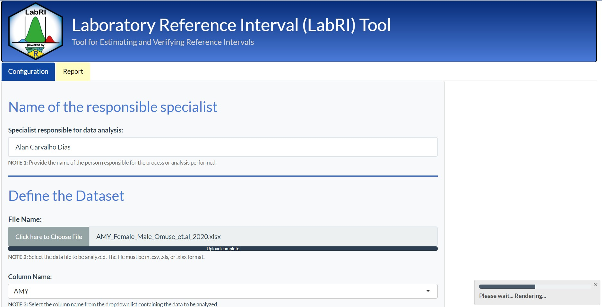

# LabRI Shiny Application

**Reference interval estimation and verification**

Local execution with R and RStudio · Analysis outputs saved on your computer

[Download](#download) · [Installation](#installation-and-launch) · [Interface](#user-interface) · [Outputs](#local-outputs) · [Methods](#analytical-workflow) · [Local vs. Connect](#local-execution-and-connect-version)

---

## Download

**Get the complete local application package**

Open the release → expand Assets → download LabRI_tool_v5.5.3.zip

Extract the entire ZIP before use, preserving its folder structure. Install R, RStudio, and the required R packages as described below.

## Overview

**LabRI (Laboratory Reference Interval)** is an R/Shiny application for reference interval estimation and verification in clinical laboratories. This implementation runs on the user's computer and presents its interface in a local browser window.

The application combines complementary statistical methods within an adaptive, multi-method consensus workflow. It supports the assessment of reference limits, their statistical uncertainty, and their agreement with comparative reference intervals.

The **local version automatically saves analytical outputs to disk**, including figures, spreadsheets, intermediate files, and HTML reports. It is intended for individual analytical workflows in which the user needs to retain and review the generated material.

## Installation and launch

### Before you start

Install **R first**, followed by **RStudio Desktop**.

| Requirement | Purpose and download |
| :--- | :--- |
| **R** | Runs the statistical procedures. [Download R](https://cran.r-project.org/). |
| **RStudio Desktop** | Provides the environment used for these installation and launch instructions. [Download RStudio Desktop](https://docs.posit.co/ide/user/download.html). |
| **Internet connection** | Required to download the application and install its R package dependencies. |
| **Writable application folder** | Allows LabRI to save outputs and HTML reports locally. |

### First-time setup

1. **Download and extract LabRI.** Open the release using the button above, download `LabRI_tool_v5.5.3.zip` under **Assets**, and extract all files to a writable folder.
2. **Open the project.** Open `Project_LabRI_Shiny.Rproj` from the extracted folder to load the project in RStudio.
3. **Open the installation document.** In RStudio, open `Install_packages.Rmd`.
4. **Install the required R packages.** Follow the document's instructions and run its installation code chunks in order. Wait until installation finishes successfully.
5. **Close the installation document.** Close the `Install_packages.Rmd` tab and keep RStudio open.
6. **Open the application.** Open `app.R` in the same project.
7. **Start LabRI.** Click **Run App** at the top of the `app.R` editor pane and wait for the interface to open.

> **First-use sequence:** extract the ZIP → open the project → install the R packages → close `Install_packages.Rmd` → open `app.R` → click **Run App**.

### Subsequent use

The package installation step is normally required only once for a given R installation. To use LabRI again:

1. Open `Project_LabRI_Shiny.Rproj`.
2. Open `app.R`.
3. Click **Run App**.

Keep RStudio and the R session running while using the application. Stop the application when the analysis is finished.

## Application components

| File | Role |
| :--- | :--- |
| **`Project_LabRI_Shiny.Rproj`** | Opens the application folder as an RStudio project. |
| **`Install_packages.Rmd`** | Provides the instructions and code for installing required R packages. |
| **`app.R`** | Defines and launches the Shiny interface. |
| **`LabRI_script.Rmd`** | Implements the analytical workflow and generates the HTML report. |

The application calls `LabRI_script.Rmd` during analysis. You do not need to run that document separately when using the Shiny interface.

## User interface

Enter the analyst's name under **Name of the Responsible Specialist**, then upload a `.csv`, `.xls`, or `.xlsx` file under **Define the Dataset** and select the column containing the results to analyze. The interface displays a processing status bar during execution.

Review the selected data column and analysis settings before processing. After execution, inspect the estimated reference limits, uncertainty assessment, figures, and generated report.

## Local outputs

The local implementation creates the following output directories within its application workspace:

| Directory | Content |
| :--- | :--- |
| **`3_Outputs/Figures/`** | Generated analytical figures. |
| **`3_Outputs/Spreadsheets/`** | Generated spreadsheets and tabular outputs. |
| **`4_Report_HTML/`** | HTML reports documenting the analysis. |

The workflow also retains intermediate analytical files. Preserve the relevant outputs together with the input dataset and the application version used for each analysis.

## Analytical workflow

LabRI uses a **data-source-agnostic statistical workflow**: its analytical procedures can be applied after a dataset has been assembled from selected reference individuals or routine laboratory results. The suitability of the data and the interpretation of the resulting intervals depend on population selection, curation, sample size, and distributional characteristics.

### Estimation module

The estimation pathway adapts to the characteristics of the distribution and the components retained after preprocessing and cluster-driven truncation.

| Stage | Purpose |
| :--- | :--- |
| **Preprocessing** | Clean the input results and assess whether transformation is indicated. |
| **Distribution assessment** | Evaluate the component structure using complementary statistical criteria and Gaussian mixture modeling. |
| **Cluster-driven truncation** | Identify the portion of the distribution retained for estimation. |
| **Adaptive estimation** | Apply the applicable parametric, nonparametric, or multi-method consensus pathway. |
| **Uncertainty and reporting** | Assess reference-limit uncertainty and document the analytical pathway in an HTML report. |

For distributions retaining multiple components, the workflow combines candidate reference limits from `refineR` and `reflimR`, with an additional EM-based estimate when its eligibility criteria are met. Two-stage winsorization and consensus aggregation reduce the influence of discrepant candidates. A single retained component follows a combined EM-parametric and nonparametric pathway.

### Verification module

When comparative reference limits are supplied, the verification workflow supports three levels of assessment:

| Level | Assessment |
| :--- | :--- |
| **1 · Statistical uncertainty** | Evaluate the uncertainty associated with the reference limits before proceeding to subsequent levels. |
| **2 · Equivalence** | Assess the distance between estimated and comparative reference limits using the workflow's equivalence criteria. |
| **3 · Concordance** | When the preceding assessment indicates possible or probable equivalence, evaluate agreement using Lin's concordance correlation coefficient, Fleiss' kappa, and flagging rates. |

These assessments support interpretation and local verification; they must be considered alongside data curation, population suitability, and clinical plausibility.

## Local execution and Connect version

The local and Connect implementations share the LabRI analytical framework and differ primarily in how execution and outputs are managed.

| Feature | Local version — this repository | Connect version |
| :--- | :--- | :--- |
| **Execution** | R running on the user's computer. | R running in the hosting environment. |
| **User interface** | Local browser window. | Browser access to the deployed application. |
| **R installation for the end user** | Required. | Not required for access to a deployed instance. |
| **Output management** | Automatic saving to local folders. | Session-specific temporary storage and user downloads. |
| **HTML report** | Displayed in the interface and saved locally. | Viewed in the interface and downloaded by the user. |
| **Main use** | Individual analyses with retained local outputs. | Hosted access, demonstrations, and training. |
| **Available resources** | Depend on the user's computer. | Depend on the hosting configuration. |

For hosted deployment, use **[LabRI_shiny_connect](https://github.com/labrgrupo/LabRI_shiny_connect)** and its deployment instructions. A [public browser demonstration](https://labrgroup-labri.share.connect.posit.cloud/) is also available. Deployment to other Shiny hosting environments may require configuration changes.

## Documentation

- **Installation and usage tutorials:** [Grupo Lab R website](https://grupolabr.com/).
- **Study datasets and reports:** [Supplementary material repository](https://github.com/labrgrupo/Supplementary_Material_CCA_LabRI).

## Contact and support

Report reproducible problems and suggest improvements through the repository's [Issues page](https://github.com/labrgrupo/LabRI_shiny/issues). Include the application version, R version, operating system, and error message when reporting a problem.

| Contact | Email |
| :--- | :--- |
| **Alan Carvalho Dias** | [alancdias@hotmail.com](mailto:alancdias@hotmail.com) |
| **Grupo Lab R** | [labrgrupo@gmail.com](mailto:labrgrupo@gmail.com) |

## License

Distributed under the **GPL-3.0** license. See [LICENSE.txt](LICENSE.txt) for the license terms.

---

<strong>LabRI Shiny Application · Local version</strong> Developed by Alan Carvalho Dias · Grupo Lab R

